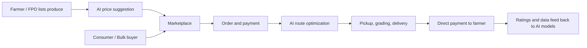

# Smart India Hackathon Workshop
# Date:
## Reference Number:
## Name:

## Problem Title
SIH 26033: Multiple intermediaries reduce farmers earnings and increase consumer prices.

## Problem Creater's Organization
Ministry of Consumer Affairs, Food & Public Distribution

## Theme
Agriculture, FoodTech & Rural Development

## Problem Description
Expected Solution: Create a digital marketplace that:

• Connects farmers/FPOs directly with consumers and bulk buyers.
• Provides logistics support.
• Uses AI for demand forecasting and route optimization.

Benefits:

• Better prices for farmers.
• Lower prices for consumers.
• Reduced supply chain inefficiencies.

# Proposed Solution

**1. Detailed explanation of the proposed solution**

We propose **KisanDirect**, a mobile-first digital marketplace that connects farmers and Farmer Producer Organizations (FPOs) directly with consumers, retailers, restaurants and bulk buyers, without layers of middlemen.

- **Farmer / FPO app:** farmers list produce (crop, quantity, quality grade, expected harvest date, photos) in their local language, using voice input and simple icons for low-literacy users.
- **Buyer app / web portal:** consumers buy fresh produce directly; bulk buyers (hotels, retailers, processors) place large or recurring orders and can pre-book upcoming harvests.
- **Logistics support:** pickup from village collection points, pooled transport, and last-mile delivery through partnered logistics providers, with live order tracking.
- **AI engine:** demand forecasting, price recommendation and route optimization (see Technical Approach).
- **Transparent pricing:** the buyer sees the farmer's price, logistics cost and platform fee separately, and the farmer is paid directly into their bank account through UPI.
- **Trust layer:** quality grading, ratings for sellers and buyers, and a dispute-resolution process.

**2. How it addresses the problem**

| Problem | How KisanDirect addresses it |
|---|---|
| Many intermediaries take a margin at each stage | Direct farmer-to-buyer trade removes layers; only a small transparent platform and logistics fee remains |
| Farmers lack price information and bargaining power | Live mandi and market price data plus AI price suggestions help farmers set fair prices |
| Poor logistics and high post-harvest losses | Pooled transport, route optimization and demand-matched dispatch reduce spoilage and cost |
| Mismatch between supply and demand | Demand forecasting guides farmers on what and when to sell, and buyers can pre-book |
| Delayed or uncertain payments | Digital payments directly to the farmer's bank account |

**3. Innovation and uniqueness of the solution**

- End-to-end platform combining marketplace, logistics and AI in one place, rather than only a listing service.
- Pre-harvest booking with forecast-based matching of supply to demand.
- Voice-first, multilingual interface designed for rural users, with an offline-friendly mode for poor connectivity.
- FPO dashboard to aggregate produce from many small farmers so they can serve bulk buyers.
- Price-transparency breakdown shown to both sides, which builds trust and supports the Ministry's price-monitoring goals.
- Integration with government data sources (mandi prices, weather) to provide context for decisions.

## Technical Approach

**1. Technologies to be used**

- **Frontend:** React Native / Flutter (farmer and buyer apps), React (web portal and admin dashboard)
- **Backend:** Node.js (Express) or Python (FastAPI), REST APIs
- **Database:** PostgreSQL (orders, users, listings), MongoDB (catalogue, logs), Redis (caching)
- **AI / ML:** Python, scikit-learn, Prophet / LSTM for demand and price forecasting; Google OR-Tools or similar for route optimization (vehicle routing problem)
- **Speech and language:** speech-to-text and translation APIs (e.g. Bhashini) for regional-language voice interaction
- **Payments:** UPI / payment gateway integration
- **Maps and logistics:** Google Maps / OpenStreetMap APIs for routing and tracking
- **Cloud and DevOps:** AWS / Azure / GCP, Docker, CI/CD with GitHub Actions
- **Security:** OTP-based login, JWT authentication, HTTPS, role-based access control

**2. Methodology and process for implementation**

1. **Onboarding:** farmers and FPOs register with mobile OTP and basic KYC (Aadhaar / bank details as permitted).
2. **Listing:** the farmer lists produce, quantity, grade and availability date.
3. **Price guidance:** the AI engine suggests a fair price using market data, season and demand trends.
4. **Ordering:** consumers or bulk buyers browse, order or pre-book, and pay online.
5. **Logistics planning:** orders are grouped by location and the route optimizer assigns pickup and delivery routes.
6. **Delivery and quality check:** produce is collected, graded and delivered, with live tracking.
7. **Settlement:** payment is released directly to the farmer after delivery confirmation.
8. **Feedback loop:** ratings and transaction data are used to retrain forecasting models.

**Flow chart:**

*(Add screenshots of the working prototype / UI mockups here.)*

## Feasibility and Viability

**1. Analysis of the feasibility of the idea**

- **Technical:** all components (mobile apps, payments, maps, forecasting models) use mature, widely available technologies.
- **Operational:** FPOs and collection centres already exist in many regions and can act as aggregation and pickup points, so the platform can start with them instead of building new infrastructure.
- **Economic:** revenue can come from a small commission, logistics margins and premium services for bulk buyers, while savings from removing intermediaries leave room for better farmer prices and lower consumer prices.
- **Policy fit:** aligns with existing government efforts such as e-NAM, FPO promotion and Digital India, and can complement them.
- **Scalability:** a pilot in one district or crop cluster can be expanded region by region.

**2. Potential challenges and risks**

- Low digital literacy and limited internet access in rural areas
- Farmer and buyer trust in a new platform, and resistance from existing middlemen
- Quality inconsistency and disputes over grading
- Perishability and last-mile logistics cost in remote areas
- Price volatility and limited historical data for accurate AI forecasts
- Payment and data-security concerns

**3. Strategies for overcoming these challenges**

- Voice-based, regional-language, offline-friendly app; assistance through FPOs, Common Service Centres and village-level agents
- Start with pilot clusters and trusted FPOs; use ratings, verified profiles and escrow-style payment release to build trust
- Standard grading guidelines, photo and quality verification at collection points, and a clear dispute-resolution process
- Pooled transport, collection hubs and demand-matched dispatch to cut spoilage and cost
- Combine open government data (mandi prices, weather) with platform data, and improve models as transactions grow
- Secure payments, encryption and compliance with applicable data-protection rules

## Impact and Benefits

**1. Potential impact on the target audience**

- **Farmers / FPOs:** higher realised prices, quicker and assured payments, better market access and price information.
- **Consumers:** fresher produce at lower prices with transparent pricing.
- **Bulk buyers:** reliable, traceable supply and the ability to plan purchases in advance.
- **Government and policymakers:** better visibility into supply, demand and price trends to support planning and price monitoring.

**2. Benefits of the solution**

- **Social:** empowers small and marginal farmers, strengthens FPOs and creates rural logistics and agent jobs.
- **Economic:** reduces the share taken by intermediaries, improves farmer income and lowers consumer prices.
- **Environmental:** lower food waste through demand matching and shorter supply chains; fewer, more efficient transport trips through route optimization.
- **Systemic:** a more transparent and efficient agricultural supply chain.

## Research and References

1. e-NAM (National Agriculture Market): https://enam.gov.in
2. Agmarknet, agricultural marketing price data: https://agmarknet.gov.in
3. Department of Consumer Affairs, price monitoring: https://consumeraffairs.nic.in
4. Open Network for Digital Commerce (ONDC): https://ondc.org
5. Bhashini, Indian language AI services: https://bhashini.gov.in
6. Central Sector Scheme for formation and promotion of 10,000 FPOs, Ministry of Agriculture & Farmers Welfare: https://agricoop.gov.in
7. Smart India Hackathon portal: https://www.sih.gov.in
